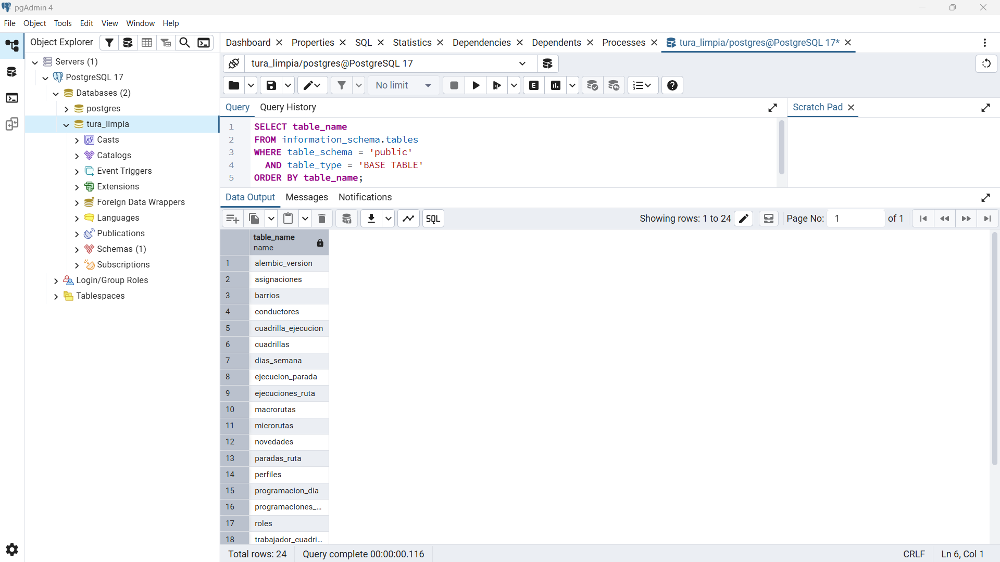
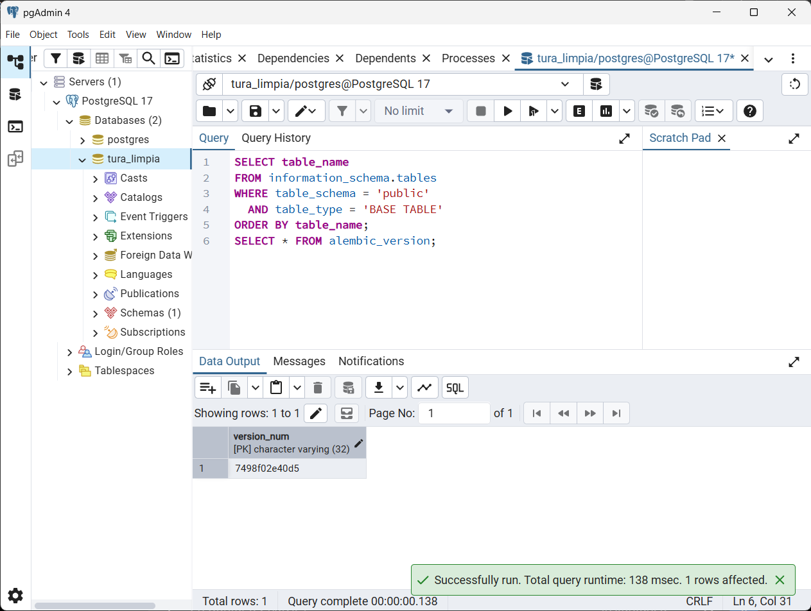
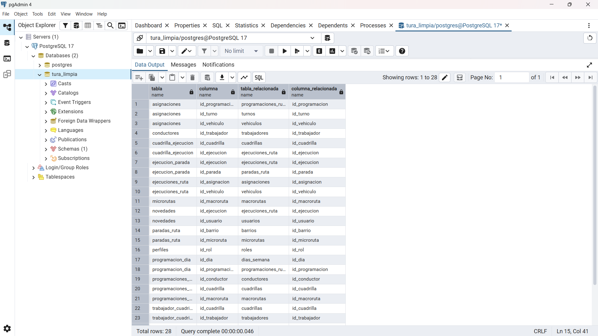

# Migraciones de la base de datos — Tura Limpia

## 1. Descripción

Este documento registra la migración inicial de la base de datos de **Tura Limpia**. El backend utiliza **Python, SQLAlchemy y Alembic**, y la base de datos se ejecuta en **PostgreSQL**.

Las migraciones permiten mantener un historial de los cambios de estructura de la base de datos y aplicarlos de forma controlada en los distintos entornos del proyecto. Este documento se concentra en la migración; la definición detallada de los modelos se documenta por separado.

## 2. Archivos involucrados

Desde la raíz del repositorio:

| Archivo | Función |
| --- | --- |
| `backend/alembic.ini` | Configuración de Alembic y de la conexión utilizada para ejecutar migraciones. |
| `backend/alembic/env.py` | Carga los metadatos de SQLAlchemy (`Base.metadata`) y configura la ejecución de las migraciones. |
| `backend/alembic/versions/7498f02e40d5_crear_tablas_iniciales_del_sistema.py` | Migración inicial con las operaciones para crear y eliminar las tablas. |
| `backend/src/models/` | Modelos de SQLAlchemy que representan la estructura de datos. |

> **Seguridad:** no se deben subir contraseñas ni cadenas de conexión con credenciales reales al repositorio. Cada integrante debe configurar su conexión local de forma segura.

## 3. Integración de Alembic con SQLAlchemy

En `backend/alembic/env.py` se importa la clase base de SQLAlchemy y el paquete de modelos:

```python
from src.core.database import Base
import src.models

target_metadata = Base.metadata
```

Con `target_metadata`, Alembic dispone de los metadatos que describen las tablas y sus relaciones. Esto permite **comparar** la estructura definida en los modelos con el esquema de la base de datos al solicitar una revisión autogenerada.

### 3.1. Detección de cambios

Para generar una **nueva propuesta** de migración a partir de diferencias entre los modelos y PostgreSQL se puede utilizar:

```bash
alembic revision --autogenerate -m "descripcion del cambio"
```

La detección automática depende de que los modelos estén importados y de que `target_metadata` esté configurado. **El archivo generado debe revisarse antes de aplicarse**, ya que no todos los cambios pueden detectarse correctamente. La configuración observada permite esta comparación, pero no se verificó qué comando utilizó el compañero para crear la revisión inicial.

La ejecución de migraciones en línea está configurada en `env.py` mediante `engine_from_config(...)` y `context.configure(...)`, usando la URL definida para Alembic. Por seguridad, no se incluyen credenciales en este documento.

## 4. Migración inicial

| Dato | Valor |
| --- | --- |
| Nombre | Crear tablas iniciales del sistema |
| Identificador (`revision`) | `7498f02e40d5` |
| Revisión anterior (`down_revision`) | `None` |
| Fecha registrada en el archivo | 14 de noviembre de 2026 |
| Herramienta | Alembic |
| Motor de base de datos | PostgreSQL |

Esta es la primera migración del historial, por lo que no depende de una revisión anterior.

### 4.1. ¿Qué hace `upgrade()`?

La función `upgrade()` crea la estructura inicial mediante operaciones de Alembic como `op.create_table()` y `op.create_index()`. Las definiciones incluyen columnas, tipos de datos, claves primarias, claves foráneas, restricciones e índices.

Las **23 tablas** se agrupan a continuación según su función dentro del sistema:

| Área | Tablas |
| --- | --- |
| Territorio y rutas | `barrios`, `macrorutas`, `microrutas`, `paradas_ruta` |
| Personal y organización | `cuadrillas`, `trabajadores`, `conductores`, `trabajador_cuadrilla` |
| Usuarios y permisos | `usuarios`, `roles`, `perfiles`, `usuario_perfil` |
| Recursos y horarios | `vehiculos`, `turnos`, `dias_semana` |
| Planificación y asignación | `programaciones_ruta`, `programacion_dia`, `asignaciones` |
| Seguimiento de operaciones | `ejecuciones_ruta`, `cuadrilla_ejecucion`, `ejecucion_parada`, `novedades`, `ubicaciones_gps` |

Algunas decisiones de estructura que aparecen en la migración son:

- **Claves primarias:** identifican cada registro de manera única; algunas tablas utilizan UUID generados con `gen_random_uuid()`.
- **Claves foráneas:** conectan registros entre tablas, por ejemplo, las microrutas con las macrorutas.
- **Índices:** facilitan las búsquedas sobre columnas definidas en la migración.
- **Restricciones de unicidad:** evitan valores repetidos donde el modelo lo requiere, como la placa del vehículo.
- **Reglas de eliminación:** algunas relaciones utilizan `CASCADE`, `RESTRICT` o `SET NULL`, según corresponda.
- **Valores predeterminados:** determinados campos de estado reciben valores iniciales definidos por la base de datos.

### 4.2. ¿Qué hace `downgrade()`?

La función `downgrade()` contiene las operaciones inversas: elimina los índices y las tablas creadas por esta revisión, siguiendo un orden compatible con sus dependencias.

**Advertencia:** ejecutar una reversión puede eliminar tablas y sus datos. Debe hacerse únicamente cuando se haya evaluado el impacto y exista un respaldo adecuado. No se ejecutó una reversión durante las pruebas documentadas aquí.

## 5. Cómo ejecutar la migración

Los siguientes comandos se ejecutan desde la carpeta `backend/`, con el entorno de Python y las dependencias del proyecto instaladas y con PostgreSQL configurado.

### 5.1. Consultar el estado actual

```bash
alembic current
```

Muestra la revisión registrada actualmente en la base de datos. Si aún no se ha aplicado ninguna migración, puede no mostrar un identificador.

### 5.2. Aplicar las migraciones pendientes

```bash
alembic upgrade head
```

`head` indica la última revisión disponible. En la prueba realizada se ejecutó la migración inicial:

```text
INFO  [alembic.runtime.migration] Context impl PostgresqlImpl.
INFO  [alembic.runtime.migration] Will assume transactional DDL.
INFO  [alembic.runtime.migration] Running upgrade  -> 7498f02e40d5, Crear tablas iniciales del sistema
```

### 5.3. Consultar el historial

```bash
alembic history
```

Permite revisar las revisiones disponibles en el proyecto.

> No es necesario volver a ejecutar `upgrade head` para crear las mismas tablas si la revisión ya figura como aplicada. Alembic utiliza `alembic_version` para llevar el control.

## 6. Verificación en PostgreSQL

Las comprobaciones se realizaron en una base local llamada `tura_limpia`, utilizando **pgAdmin 4**. Antes de aplicar la migración se verificó que el esquema `public` no contenía tablas.

### 6.1. Consultar las tablas creadas

```sql
SELECT table_name
FROM information_schema.tables
WHERE table_schema = 'public'
  AND table_type = 'BASE TABLE'
ORDER BY table_name;
```

**Resultado observado:** 24 tablas en total: las **23 tablas funcionales** del sistema y la tabla **`alembic_version`**, que administra Alembic.



*Figura 1. Tablas presentes en el esquema `public` después de aplicar la migración.*

### 6.2. Verificar la revisión aplicada

```sql
SELECT * FROM alembic_version;
```

**Resultado observado:** `7498f02e40d5`.



*Figura 2. Revisión de Alembic registrada en PostgreSQL.*

### 6.3. Consultar las relaciones entre tablas

```sql
SELECT
    tc.table_name AS tabla,
    kcu.column_name AS columna,
    ccu.table_name AS tabla_relacionada,
    ccu.column_name AS columna_relacionada
FROM information_schema.table_constraints AS tc
JOIN information_schema.key_column_usage AS kcu
    ON tc.constraint_name = kcu.constraint_name
   AND tc.table_schema = kcu.table_schema
JOIN information_schema.constraint_column_usage AS ccu
    ON ccu.constraint_name = tc.constraint_name
   AND ccu.constraint_schema = tc.table_schema
WHERE tc.constraint_type = 'FOREIGN KEY'
  AND tc.table_schema = 'public'
ORDER BY tc.table_name, kcu.column_name;
```

**Resultado observado:** 28 relaciones por claves foráneas. Entre ellas se encuentran las relaciones de `microrutas` con `macrorutas`, de `paradas_ruta` con `barrios` y `microrutas`, y de `ejecuciones_ruta` con `asignaciones` y `vehiculos`.



*Figura 3. Consulta de claves foráneas de las tablas del sistema.*

## 7. Resultado de las pruebas

| Comprobación | Resultado |
| --- | --- |
| Conexión de Alembic a PostgreSQL | Correcta |
| Tablas existentes antes de aplicar la migración | 0 |
| Ejecución de `alembic upgrade head` | Sin errores reportados |
| Tablas funcionales creadas | 23 |
| Tabla de control `alembic_version` | Presente |
| Revisión registrada | `7498f02e40d5` |
| Relaciones por claves foráneas consultadas | 28 |

Las verificaciones confirman que la migración inicial se aplicó en el entorno local probado y que PostgreSQL registró la revisión correspondiente. No constituyen, por sí solas, pruebas de todas las operaciones de la aplicación ni de la reversión de la migración.

## 8. Consideraciones para el equipo

- Antes de aplicar migraciones, comprobar que la conexión apunta a la base de datos correcta.
- Mantener las migraciones bajo control de versiones para que el equipo pueda reproducir los cambios.
- Crear nuevas revisiones cuando se modifique la estructura de los modelos; no editar una migración que ya se aplicó en entornos compartidos sin coordinarlo.
- Revisar el código generado por Alembic antes de ejecutarlo, especialmente cuando implique eliminar columnas o tablas.
- Evitar subir archivos de configuración con credenciales reales.

## 9. Conclusión

La migración `7498f02e40d5` permitió crear la estructura inicial de la base de datos de Tura Limpia. En las pruebas locales, Alembic ejecutó la revisión sin errores y PostgreSQL mostró las 23 tablas del sistema, su tabla de control y las relaciones definidas. Con este archivo queda documentado qué incluye la migración, cómo aplicarla y cómo verificar su resultado.
